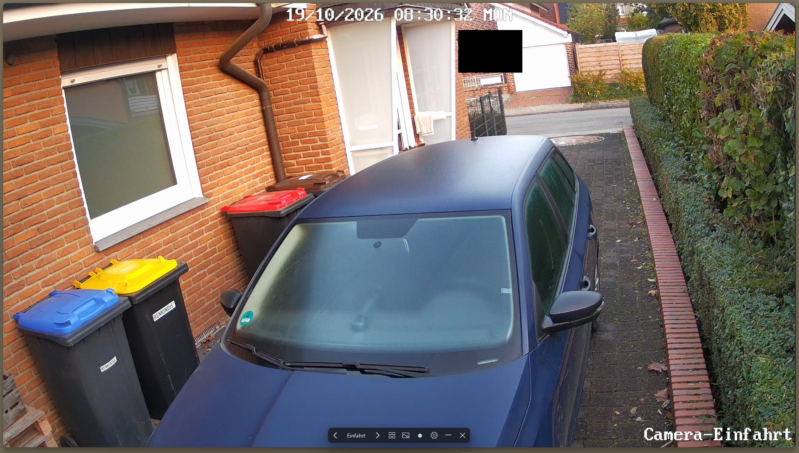
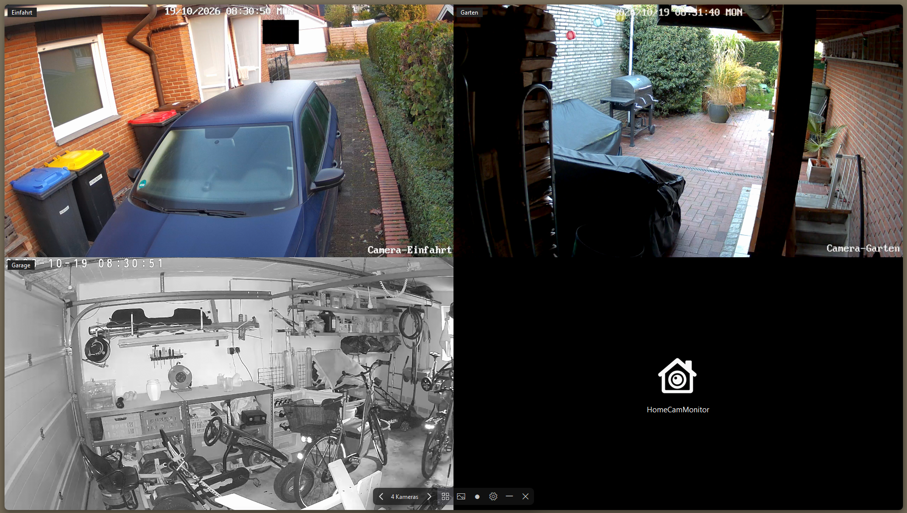
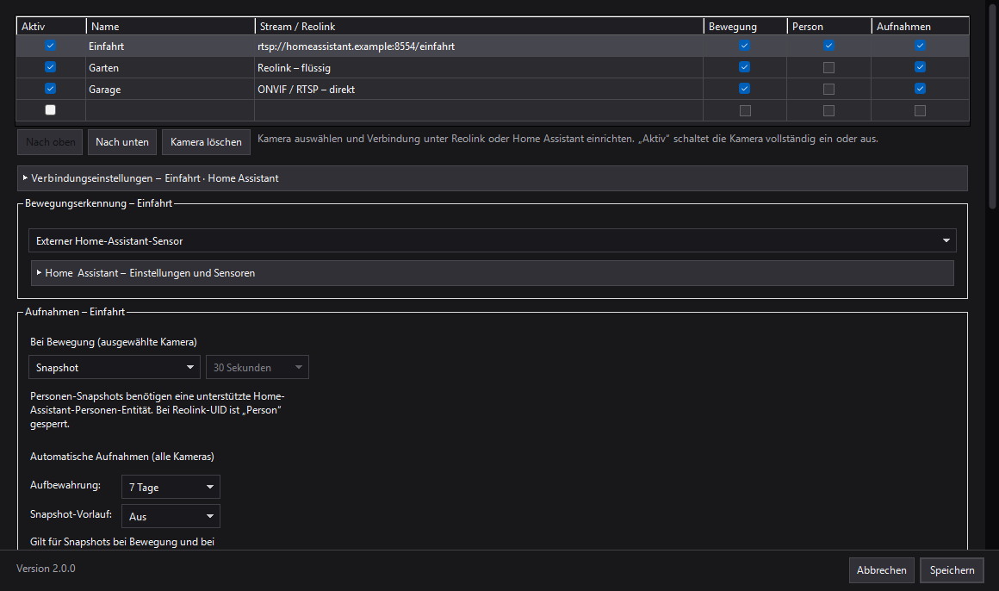
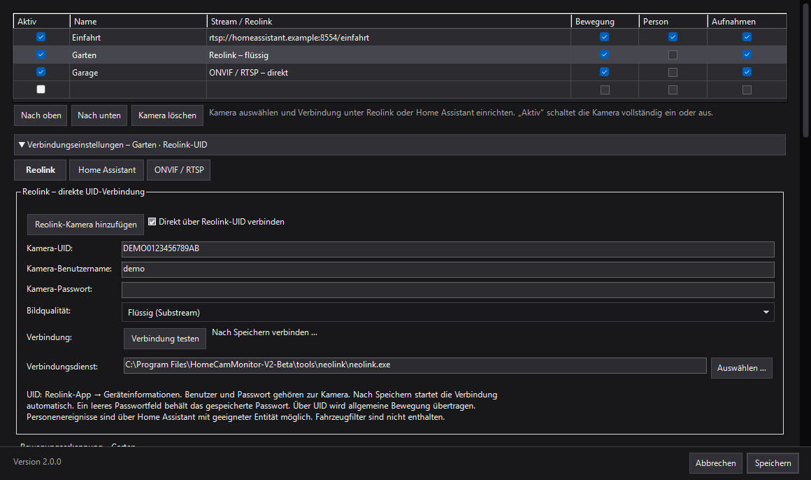
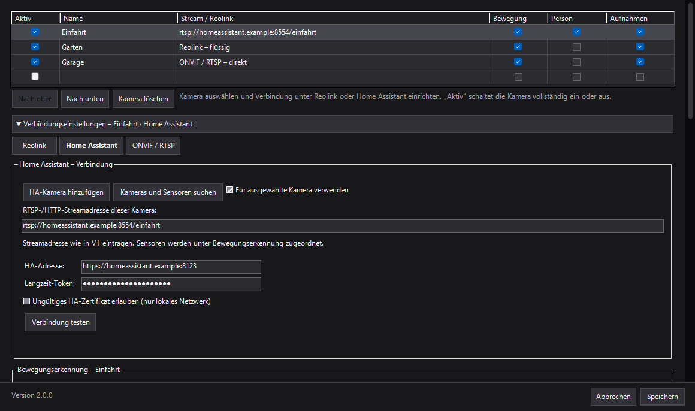
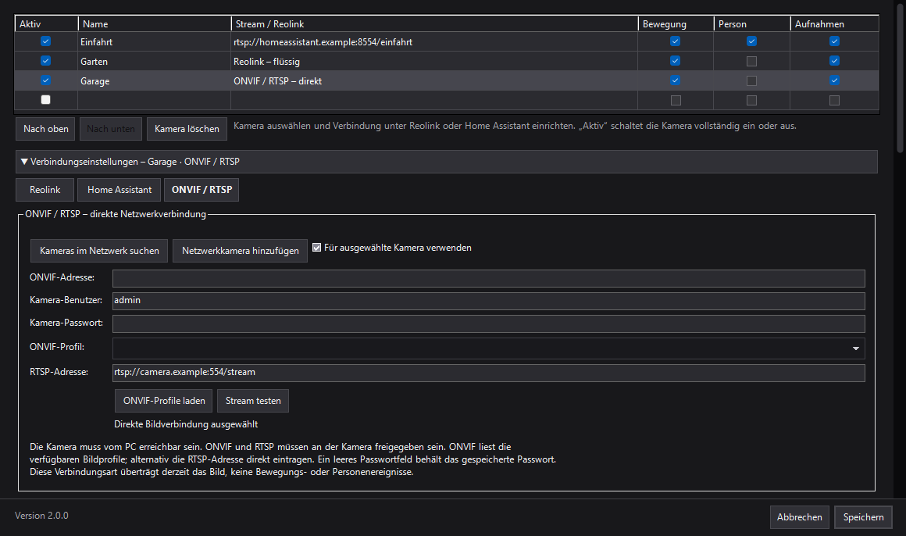
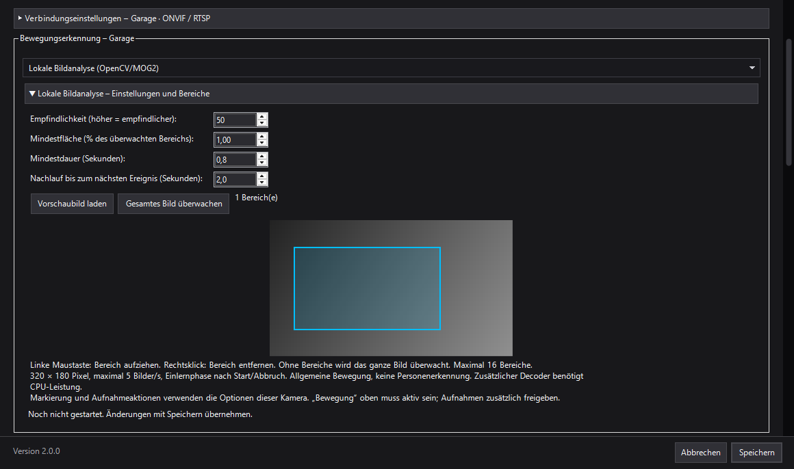
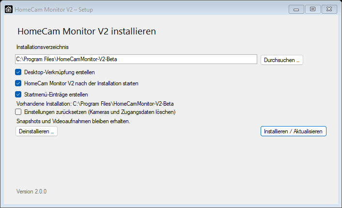

# HomeCam Monitor V2 – IP-Kamera-Monitor und RTSP-Player für Windows

<p align="center">
  
</p>

<p align="center">
  Kostenloser Windows-Kameramonitor für IP-Kameras und RTSP-Livestreams – mit optionaler Home-Assistant-Integration.
</p>

HomeCam Monitor V2 ist ein kostenloser IP-Kamera-Viewer und RTSP-Player für Windows. Er zeigt Livestreams von Netzwerk- und Überwachungskameras in einem rahmenlosen Fenster oder einer 4-Kamera-Ansicht. Snapshots, Videoaufnahmen und optional Home Assistant ergänzen den Kameramonitor. Die mpv-Video-Engine verwendet Direct3D 11; das Fenster bleibt auf Wunsch im Vordergrund und verbindet abgebrochene Streams automatisch neu.

**English:** Free Windows IP camera viewer and RTSP camera monitor with a four-camera view, snapshots, video recording, pre-recording and optional Home Assistant motion/person sensor integration. Home Assistant is not required to view camera streams.

## Aktuell: Version 2.0.12.0

**HomeCam Monitor V2 – 2.0.12.0** verwendet dieselbe Versionsnummer in der App, auf GitHub und im Microsoft-Store-Paket. Das Update korrigiert die Standardpfade bei Neuinstallation, verbessert die Logo-/Iconvorschau und enthält die deutsche/englische Oberfläche sowie die bisherigen Store-Korrekturen.

[Release und Downloads 2.0.12.0](https://github.com/kulmi84/HomeCam-Monitor/releases/tag/v2.0.12.0) · [Änderungen und Upgrade](docs/release-v2.0.12.0.md) · [Microsoft Store](https://apps.microsoft.com/detail/9P6668481MGG)

Die Store-Freigabe erfolgt durch Microsoft. Beide Ausgaben werden aus derselben Versionsangabe in `Directory.Build.props` gebaut. Gespeicherte Kameraeinstellungen und selbst gewählte Speicherpfade bleiben erhalten.

### Einzelkamera

Ein Kamerabild im rahmenlosen Fenster mit direkt erreichbarer Bedienleiste für Kamerawechsel, Rasteransicht, Snapshots, Aufnahmen und Einstellungen.



### Vierer-Raster

Bis zu vier Kameras gleichzeitig im Blick. Nicht belegte Felder zeigen auf Wunsch das HomeCam-Logo.



## V2.0.0 – Grundlage der finalen Anwendung

Der Produktname der aktuellen Generation lautet **HomeCam Monitor V2**, einheitlich für GitHub und die geplante Microsoft-Store-Ausgabe. **2.0.0** bezeichnet die Versionsnummer des hier veröffentlichten GitHub-Releases. **HomeCam Monitor V1** bleibt als separate ältere Ausgabe erhalten.

Die bewährte Beta **2.0.0-beta.37** ist die Grundlage der finalen **V2.0.0**. Die [finale Version ist veröffentlicht](https://github.com/kulmi84/HomeCam-Monitor/releases/tag/v2.0.0): Installer, portable ZIP, HomeCam-Quellcode und die drei vollständigen Fremdkomponenten-Quellenarchive stehen dauerhaft bereit. Die [technische Komponentenprüfung](docs/third-party-release-audit-v2.md) ist abgeschlossen; alle zehn Release-Anhänge wurden anhand ihrer SHA-256-Prüfsummen kontrolliert. Vorhandene V2-Einstellungen bleiben erhalten. [Paketbau und Upgrade-Hinweise](docs/release-v2.0.0.md).

### Funktionen und Bilder

**HomeCam Monitor V2.0.0** verwendet eine eigene Anwendung und von V1 getrennte Einstellungen. Die [V2.0.0-Anleitung mit Bildern](docs/v2.0.0.md) erklärt Einrichtung, Kameraquellen, Sensoren und Aufnahmen. V1.0.0 bleibt als bisheriger öffentlicher Download erhalten.

- Drei Verbindungsarten: **Reolink-UID**, **Home Assistant** und direktes **ONVIF/RTSP**.
- Netzwerk- und HA-Kamerasuche, ONVIF-Streamprofile und HA-Sensorzuordnung.
- Kameras aktivieren, sortieren und löschen; Bewegung, Personenereignisse und Aufnahmen pro Kamera.
- Wahl zwischen Kamera-/HA-Ereignissen und **lokaler Bewegungserkennung mit OpenCV/MOG2**. ONVIF/RTSP nutzt für Bewegung die lokale Analyse.
- Empfindlichkeit, Mindestfläche, Mindestdauer und Überwachungsbereiche je Kamera; bestehende externe Sensoren bleiben erhalten.
- Eingeklappte Verbindungseinstellungen und Bewegungsdetails, dunkle Auswahllisten und Scrollleisten. Beta37 puffert die Einstellungsfelder beim Scrollen gemeinsam.



### Reolink direkt über UID

Kameraeigene Bewegungsereignisse benötigen keinen HA-Sensor. Alternativ steht lokale Bildanalyse zur Verfügung.



### Home Assistant

Verbindung und Streamadresse stehen getrennt von der Ereignis- und Sensorzuordnung. Die Suche listet HA-Kameras und passende Sensoren auf.



### ONVIF/RTSP und Kamerasuche

Direkt erreichbare Netzwerkkameras lassen sich über ONVIF suchen, mit ihren Streamprofilen übernehmen oder mit einer manuellen RTSP-Adresse einrichten. Eine ergänzende Portsuche prüft einen gewählten IPv4-Bereich; ein offener Port bestätigt noch keinen Stream. Für Bewegung steht bei dieser Verbindung lokale Bildanalyse zur Verfügung.



### Lokale Bewegungserkennung

Empfindlichkeit, Mindestfläche, Mindestdauer und Überwachungsbereiche werden je Kamera eingestellt. Die Vorschau zeigt hier ein synthetisches Testbild.



[**V2.0.0-Anleitung mit Bildern**](docs/v2.0.0.md) · [Release und Upgrade](docs/release-v2.0.0.md) · [Technische Hinweise und Versionshistorie](docs/v2-beta.md) · [V2-Quellcode](https://github.com/kulmi84/HomeCam-Monitor/tree/main)

Der Quellstand enthält V1 und die separate finale V2.0.0. [Pull Request #3](https://github.com/kulmi84/HomeCam-Monitor/pull/3) wurde nach dem erfolgreichen [Windows-Build #295](https://github.com/kulmi84/HomeCam-Monitor/actions/runs/39050341220) übernommen. Geprüft wurden unter anderem Oberfläche, Videowiedergabe, Aufnahmen, Reolink-Dienst, lokale Bewegungserkennung sowie V2-Installation und Deinstallation.

### Update und Installation

Der V2.0.0-Installer beendet die Anwendung im gewählten Zielordner, übernimmt vorhandene V2-Kameras und Einstellungen und bereinigt zugehörige alte Beta-Verknüpfungen. **Einstellungen zurücksetzen** für ein normales Update ausgeschaltet lassen. Einige interne Datei- und Ordnernamen behalten aus Kompatibilitätsgründen `V2-Beta`; die Oberfläche zeigt Version **2.0.0**. V1 wird separat behandelt.



Die Einstellungs-Screenshots zeigen die Anwendung mit erfundenen Kameradaten. Die Vorschau der lokalen Analyse ist synthetisch. Die Bilder der Einzelkamera und des Vierer-Rasters wurden vom Nutzer für die Produktbeschreibung bereitgestellt. Öffentliche V2-Installer setzen die dauerhafte Bereitstellung der geprüften Quellenpakete voraus; bestehende V1-Downloads bleiben unverändert.

## V1.0.0 bleibt verfügbar

Die bisher veröffentlichte V1.0.0 bleibt getrennt von V2 nutzbar. Ihre [Anleitung](docs/v1.0.0.md), [Release-Hinweise](docs/release-v1.0.0.md), [Downloads](https://github.com/kulmi84/HomeCam-Monitor/releases/tag/v1.0.0) und korrespondierenden Medienquellen bleiben erhalten. V1-Installer sind keine V2-Updates.

## V2 aus dem Quellcode bauen

Voraussetzungen: Windows x64 und .NET 8 SDK. Der finale Anwendungsmodus wird ausdrücklich mit `FinalRelease=true` gebaut:

```powershell
dotnet publish HomeCamMonitor.V2.Beta.csproj -c Release -r win-x64 --self-contained true -p:FinalRelease=true -p:PublishSingleFile=false -o publish-v2-release
```

Der reine .NET-Build enthält noch nicht alle externen Programme. Für Wiedergabe, Aufnahmen und Reolink müssen die passenden mpv-/FFmpeg-Dateien, Neolink und dessen private GStreamer-Laufzeit einschließlich Lizenz- und Quellenunterlagen vorbereitet sein. Der vollständige [Windows-Workflow](.github/workflows/windows-build.yml) zeigt die Reihenfolge und führt die Tests aus.

Mit einem vorhandenen, getesteten V2-Laufzeitverzeichnis erzeugt der gemeinsame Paketbauer Setup und portable ZIP:

```powershell
.github/scripts/build-v2-release.ps1 -RuntimeTemplate publish-v2-beta
```

Die Anleitung zu [Paketbau und Upgrade](docs/release-v2.0.0.md) beschreibt die erzeugten Dateien und die dauerhaft veröffentlichten Pakete und Quellennachweise. `HomeCamMonitor.csproj` baut weiterhin V1.0.0. Die [historischen V1-Beta-Notizen](docs/v1-beta-history.md) und die [V2-Beta-Historie](docs/v2-beta.md) bleiben zum Nachlesen erhalten.

## Lizenz


HomeCam Monitor ist als proprietäre Freeware vorgesehen. Die unveränderte offizielle Anwendung darf kostenlos genutzt werden. Änderungen, Weitergabe von Paketen, Forks, Weiterentwicklung und Verwendung des geschützten HomeCam-Codes für eigene Projekte erfordern die vorherige Zustimmung des Rechteinhabers, soweit keine zwingenden Rechte entgegenstehen. Benutzerkonfiguration und Links zu offiziellen Downloads dürfen frei geändert bzw. geteilt werden.

Der [vorbereitete Lizenztext](LICENSE.txt) nennt Marcin Kulmaczewski als Rechteinhaber und liegt zur abschließenden Prüfung vor. Die Rechte an mpv, FFmpeg, .NET und anderen Fremdkomponenten richten sich ausschließlich nach ihren eigenen Lizenzen; siehe [V2-Fremdkomponenten-Hinweise](THIRD-PARTY-NOTICES-V2.md). Das derzeit öffentliche Quellcode-Repository ist noch nicht in private Entwicklung und öffentliche Downloads getrennt.
