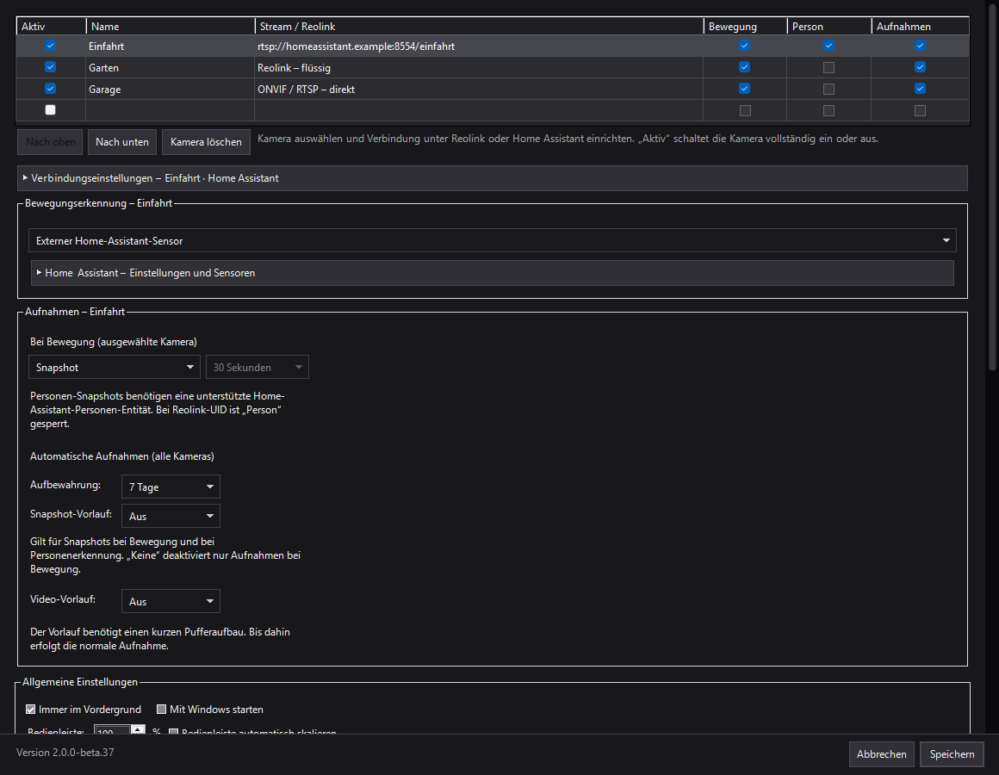
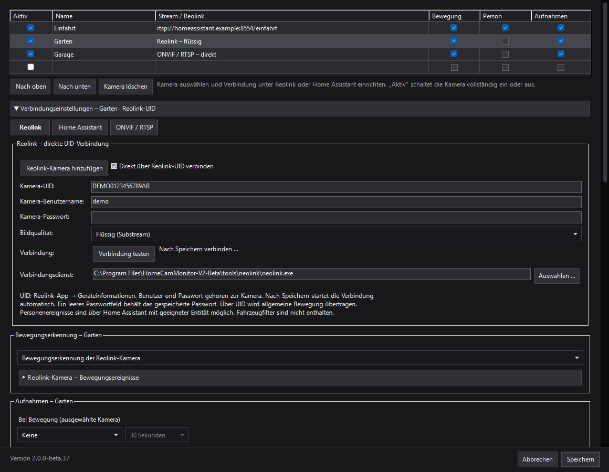
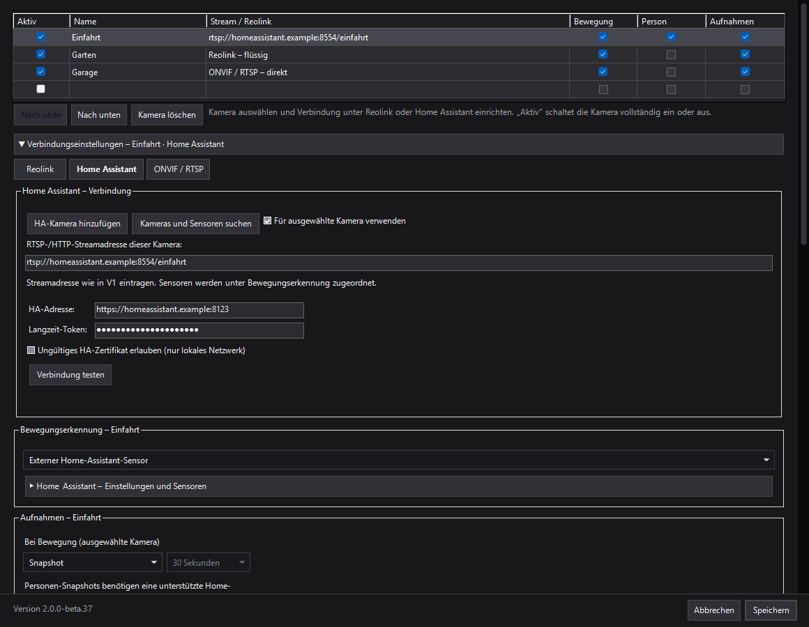
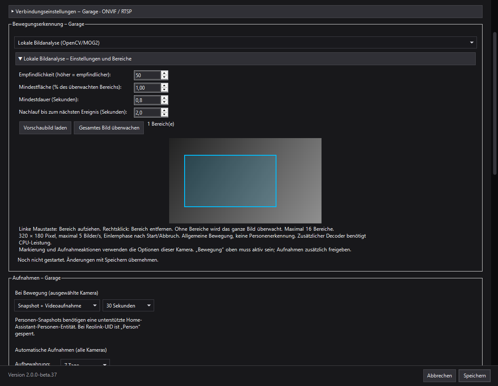

# HomeCam Monitor V2 – Beta37

Historischer Beta37-Stand: Beta37 wurde als Grundlage der finalen V2.0.0 bestätigt und hat Beta29 als aktuelle Referenz ersetzt. Die aktuelle [V2.0.0-Anleitung](v2.0.0.md) und die [Release-Hinweise](release-v2.0.0.md) enthalten den heutigen Stand.

Der Programmstand wurde mit [Pull Request #3](https://github.com/kulmi84/HomeCam-Monitor/pull/3) in den Hauptzweig übernommen. V1 und V2 bleiben separate Anwendungen mit getrennten Einstellungen.

## Einrichtung in fünf Schritten

1. Eine Kamera hinzufügen oder die Netzwerk-/HA-Suche verwenden. Bestehende Kameras bleiben beim Aktualisieren erhalten.
2. Bei **Verbindungseinstellungen** die passende Verbindungsart wählen und die nötigen Kamera- beziehungsweise HA-Zugangsdaten eintragen. Für direkte ONVIF-/RTSP-Verbindungen muss die Kamera vom PC erreichbar sein.
3. Die Verbindung beziehungsweise den Stream testen. Eine gefundene Kamera oder ein offener Port bestätigt noch keine funktionierende Bildübertragung.
4. In der Kameraliste **Aktiv** und bei Bedarf **Bewegung** setzen. Darunter die unterstützte Ereignisquelle wählen; die passenden Detailfelder werden über den Pfeil aufgeklappt. Ohne Bewegung-Haken ist der Bereich ausgeblendet.
5. Für automatische Aufnahmen zusätzlich **Aufnahmen** aktivieren, die gewünschte Aktion einstellen und speichern. Deaktivierte Kameras behalten ihre Einstellungen, werden aber nicht verwendet.

Bei lokalen Kameras können Firewall oder getrennte VLANs die Suche und Verbindung verhindern. WS-Discovery arbeitet mit lokalem Multicast und erreicht andere Netzsegmente normalerweise nicht ohne passende Netzkonfiguration. UID und Home Assistant können andere Verbindungswege nutzen; die lokale Suche ersetzt diese Wege nicht.

## Kameras und Ereignisse pro Kamera

Alle drei Verbindungsarten teilen eine Kameraliste. Kameras können deaktiviert, umsortiert und gelöscht werden. Bewegung, unterstützte Personenereignisse und automatische Aufnahmen werden pro Kamera freigegeben. Verbindungseinstellungen und Details der gewählten Bewegungsquelle starten eingeklappt.

## Reolink direkt über UID

Reolink-UID verbindet die Kamera über den mitgelieferten Neolink-Dienst. Die externe Bewegungsquelle heißt ausdrücklich „Bewegungserkennung der Reolink-Kamera“ und benötigt keinen HA-Sensor. Alternativ analysiert HomeCam Monitor den Stream lokal. Der Wechsel ändert keine Einstellungen in der Kamera und schaltet deren eigene Erkennung nicht ab. UID liefert derzeit allgemeine Bewegung, keine Personenklassifikation.

## Home Assistant

Vorhandene Streamadressen bleiben nutzbar. Die HA-Suche kann Kamera-Entitäten und passende Bewegungs-/Personensensoren auflisten; HA-Kamera-Entitäten können über einen geschützten lokalen HLS-Endpunkt abgespielt werden. go2rtc-Aliase ohne entsprechende HA-Kamera-Entität werden nicht automatisch gefunden und können manuell eingetragen werden.

HA-Adresse und Token stehen bei der Verbindung. Ereignisschalter und Sensorzuordnungen stehen bei der externen Bewegungserkennung. Lokale Analyse benötigt keinen externen Bewegungssensor; separat aktivierte HA-Personensensoren bleiben nutzbar.

## ONVIF/RTSP und lokale Bildanalyse

ONVIF-/WS-Discovery sucht Kameras, lädt nach Anmeldung Profile und RTSP-Adressen und bietet einen Streamtest. Ergänzend lassen sich typische RTSP-Ports in einem gewählten IPv4-Bereich prüfen. Ein offener Port bestätigt noch keinen Stream. Die direkte Bildverbindung empfängt derzeit keine externen Ereignisse; die Auswahl bietet deshalb ausschließlich lokale Bildanalyse an.

Die lokale Analyse nutzt OpenCV/MOG2 mit 320 × 180 Pixeln und maximal fünf Bildern pro Sekunde. Empfindlichkeit, Mindestfläche, Mindestdauer und Nachlauf sind einstellbar. Bis zu 16 rechteckige Bereiche grenzen die Überwachung ein; ohne Bereiche wird das ganze Bild überwacht. Nach Start oder Verbindungsabbruch lernt die Analyse zunächst den Hintergrund ein. Sie erkennt allgemeine Bewegung, keine Personen. Sie benötigt einen zusätzlichen Decoder und läuft nur bei gestarteter Anwendung.

## Beta37: ruhigeres Scrollen

Die Einstellungsoberfläche bewegt sich als gemeinsame Fläche. Native Eingabefelder werden im Scrollbereich zusammen gepuffert gezeichnet; das frühere Abschalten und Wiedereinschalten der Zeichenfläche bei jedem Scrollschritt entfällt.

Geprüft wurden schnelle Scrollfolgen bei aufgeklappten Verbindungs- und Analysebereichen, unveränderte Feldpositionen/-größen relativ zum Scrollversatz, kontinuierliche Sichtbarkeit sowie Sortieren, Löschen und ruhende Darstellung. Die lokale Bewegungserkennung wurde mit echtem OpenCV und FFmpeg geprüft. Der lokale Installer bestand Installation, Update, Deinstallation und den Schutz des V1-Ordners.

## Stand der Veröffentlichung

Quellcode und Screenshots dieses Entwicklungsstands sind verfügbar. Ein öffentlicher V2-Installer setzt noch die in [reolink-v2-components.md](reolink-v2-components.md) verlangte vollständige Prüfung der neuen Fremdkomponenten voraus. Der lokal geprüfte Beta37-Installer wird damit noch nicht als öffentlicher Download freigegeben.

Alle Screenshots wurden aus dem aktuellen UI-Code mit erfundenen Kameraadressen und Zugangsdaten erzeugt. Das Vorschaubild ist ein synthetisches Testbild. Die Aufnahmen enthalten keine echten Kameras oder Zugangsdaten.
